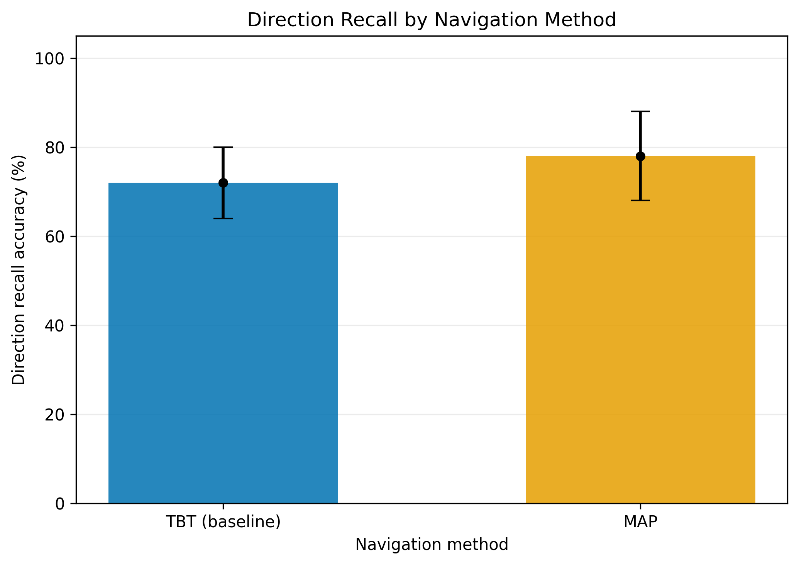
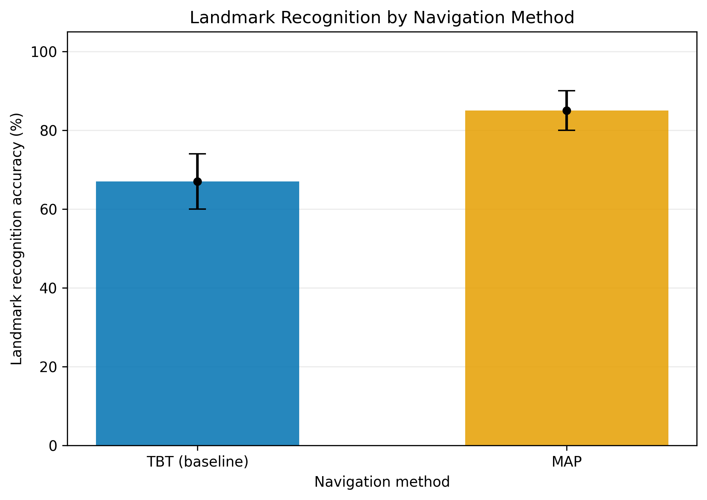
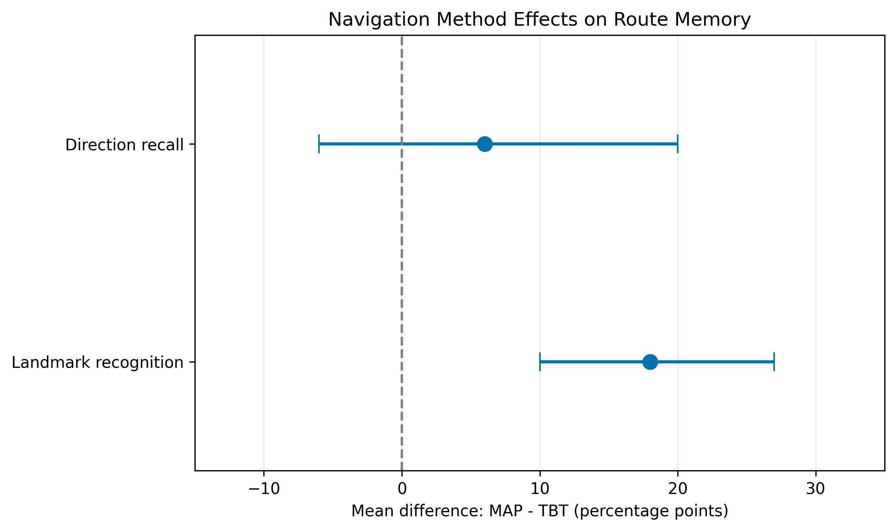
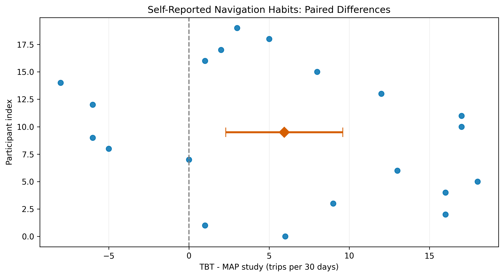

# The Effect of Digital Navigation Method on Route Memory in Young People

**Authors:** Ayaulym Serikova and Gulnar Khabibullayeva

## 1. Research Overview

This project investigates how digital navigation methods affect route memory in young people.

The experiment compares two navigation conditions:

- **TBT (baseline):** Turn-by-turn digital directions.
- **MAP:** Prior study of a digital map before walking without navigation assistance.

The research focuses on direction recall accuracy, landmark recognition accuracy, and self-reported navigation habits.

The experimental dataset contains results from 20 participants, with 10 participants in each group.

## 2. Research Questions

**RQ1:** How frequently do participants report using turn-by-turn navigation and prior digital map study for unfamiliar walking trips during the previous 30 days?

**RQ2:** Does navigation method affect direction recall accuracy after one traversal of an unfamiliar walking route?

**RQ3:** Does navigation method affect landmark recognition accuracy after one traversal of an unfamiliar walking route?

## 3. Experimental Design

The study uses a quantitative between-group experimental design.

Each participant completes one traversal of an unfamiliar walking route.

The two experimental conditions are:

- TBT: Navigation instructions are provided at predefined decision points.
- MAP: Participants study a digital map for three minutes and then walk without the map.

Route memory is assessed using:

- Five direction recall questions.
- Ten landmark recognition questions.

A standardized two-minute delay is applied before testing.

Direction recall accuracy is the primary outcome. Landmark recognition accuracy is the secondary outcome.

## 4. Data Processing and Statistical Analysis

The analysis is implemented in Python using pandas, NumPy, and Matplotlib.

The processing pipeline performs:

1. Data loading and validation.
2. Participant-level accuracy calculations.
3. Descriptive statistics.
4. Bootstrap estimation of 95% confidence intervals.
5. Between-group comparisons.
6. Scientific visualization.

Descriptive statistics include mean, median, standard deviation, and the 25th, 75th, and 95th percentiles.

Bootstrap calculations use 10,000 resamples and a fixed random seed of 42.

Group differences are calculated as:

**Difference = MAP mean - TBT mean**

Confidence intervals are estimated using the percentile bootstrap method.

## 5. Experimental Results

### 5.1. Descriptive Statistics

| Metric | Group | N | Mean (%) | Median (%) | SD |
|---|---|---:|---:|---:|---:|
| Direction recall | TBT | 10 | 72 | 80 | 13.98 |
| Direction recall | MAP | 10 | 78 | 80 | 17.51 |
| Landmark recognition | TBT | 10 | 67 | 70 | 11.60 |
| Landmark recognition | MAP | 10 | 85 | 80 | 8.50 |

### 5.2. Bootstrap Confidence Intervals

| Metric | Group | Mean (%) | 95% Bootstrap CI (%) |
|---|---|---:|---|
| Direction recall | TBT | 72 | [64, 80] |
| Direction recall | MAP | 78 | [68, 88] |
| Landmark recognition | TBT | 67 | [60, 74] |
| Landmark recognition | MAP | 85 | [80, 90] |

### 5.3. Between-Group Comparisons

| Metric | MAP - TBT (percentage points) | 95% Bootstrap CI |
|---|---:|---|
| Direction recall | +6 | [-6, 20] |
| Landmark recognition | +18 | [10, 27] |

**RQ2 interpretation:** MAP participants achieved a higher mean direction recall accuracy than TBT participants. However, the confidence interval includes zero, so the results do not provide clear evidence of a difference in direction recall.

**RQ3 interpretation:** MAP participants achieved a higher mean landmark recognition accuracy. The bootstrap confidence interval for the difference excludes zero, suggesting evidence of a difference favoring MAP in this sample.

These findings should be interpreted cautiously because each group contains only 10 participants.

## 6. Navigation Habits (RQ1)

Participants reported their navigation habits over the previous 30 days.

| Navigation method | Mean trips | Median trips |
|---|---:|---:|
| Turn-by-turn navigation | 15.65 | 15 |
| Prior digital map study | 9.70 | 10.5 |

The mean paired difference was **5.95 trips**, with a 95% bootstrap confidence interval of **[2.30, 9.60] trips**.

Participants reported more frequent use of turn-by-turn navigation than prior digital map study.

This analysis describes self-reported habits and does not establish a causal effect of navigation frequency on route memory.

## 7. Scientific Visualizations

All scientific figures are available in both high-resolution PNG (300 dpi) and vector PDF formats.

### Direction Recall Accuracy



### Landmark Recognition Accuracy



### Between-Group Differences



### Navigation Habits



## 8. Project Architecture

The research data-processing workflow is documented using C4-style Mermaid diagrams.

The architecture includes:

- Research participants and data collection.
- Original experimental data.
- Python data-processing scripts.
- Processed statistical summaries.
- Scientific visualization.
- Jupyter Notebook analysis.
- Research documentation and GitHub.

See [Domain Model](docs/domain_model.md).

## 9. Project Structure

```text
digital-navigation-method-route-memory/
|-- configs/
|   `-- config.yaml
|-- data/
|   |-- raw/                  # Private experimental data
|   |-- processed/            # Statistical summaries
|   `-- sample/               # Synthetic Task 2 sample
|-- docs/
|   |-- methodology_card.md
|   `-- domain_model.md
|-- notebooks/
|   `-- 01_data_analysis.ipynb
|-- reports/
|   `-- figures/
|-- src/
|   |-- benchmark.py
|   |-- process_data.py
|   `-- visualize.py
|-- .gitignore
|-- Dockerfile
|-- LICENSE
|-- README.md
`-- requirements.txt
```

## 10. Installation

**Requirements:** Python 3.11 or newer.

Clone the repository and install dependencies:

```bash
git clone https://github.com/ayaulymserikova13-coder/digital-navigation-method-route-memory.git
cd digital-navigation-method-route-memory
python -m pip install -r requirements.txt
```

## 11. Running the Analysis

### Task 2: Synthetic Benchmark

The original benchmark uses synthetic demonstration data.

```bash
python src/benchmark.py
```

The sample dataset is located at `data/sample/sample_results.csv`.

Synthetic Task 2 results must not be interpreted as experimental findings.

### Task 3: Experimental Data Analysis

If authorized access to the original experimental Excel dataset is available, place it at:

```text
data/raw/Route_Memory_Google_Forms_Results.xlsx
```

Then run:

```bash
python src/process_data.py
python src/visualize.py
```

Open `notebooks/01_data_analysis.ipynb` in VS Code or Jupyter and run all cells.

**Reproducibility limitation:** The original participant-level data are excluded from the public repository for privacy reasons. Recalculation from raw responses requires authorized access to the private dataset.

The repository includes aggregated statistical summaries and generated scientific figures for reviewing the reported results.

## 12. Data Quality and Limitations

The analysis checks participant identifiers, group assignments, answer categories, and accuracy ranges.

The processed dataset contains 20 participants, with 10 in each group.

Study limitations include:

- Small sample size.
- Limited generalizability.
- Self-reported navigation habits.
- Uncertainty in estimated group differences.
- Restricted public access to participant-level experimental data.

Bootstrap confidence intervals describe statistical uncertainty but do not eliminate possible experimental biases.

## 13. Methodology

The detailed methodology is available in:

[Methodology Passport Card](docs/methodology_card.md)

## 14. Citation

Serikova, A., & Khabibullayeva, G. (2026). *The Effect of Digital Navigation Method on Route Memory in Young People: A Comparison of Turn-by-Turn Directions and Prior Study of a Digital Map.* GitHub research repository.

## 15. License

This project is licensed under the MIT License. See [LICENSE](LICENSE).
