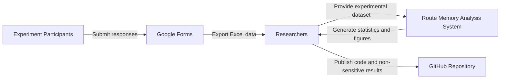
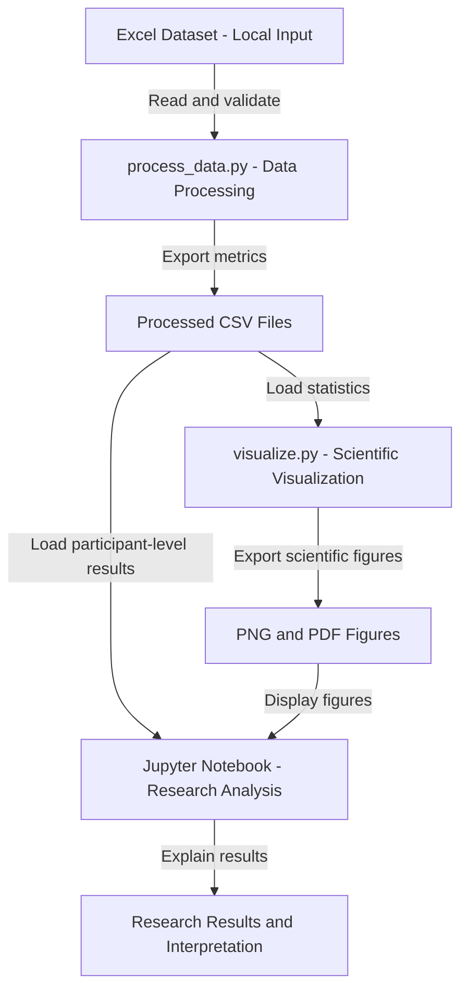

# Domain Model — Digital Navigation Route Memory

**Authors:** Ayaulym Serikova, Gulnar Khabibullayeva

## 1. System Overview

This project analyzes experimental data collected to investigate the effect of digital navigation methods on route memory.

The experiment compares two independent groups:

- **TBT:** Turn-by-turn navigation (baseline).
- **MAP:** Prior digital map study (comparison group).

The software pipeline validates participant responses, calculates route-memory accuracy, estimates statistical uncertainty, and generates scientific visualizations.

## 2. C4 Model — System Context

### System Context Explanation

- **Experiment Participants:** Complete direction recall, landmark recognition, and navigation habits questions.
- **Google Forms:** Collects experimental responses.
- **Researchers:** Export the dataset, execute the analysis, and interpret the results.
- **Route Memory Analysis System:** Processes the responses and produces statistical outputs.
- **GitHub Repository:** Stores reproducible code, documentation, and non-sensitive research artifacts.

## 3. C4 Model — Container View

### Container Responsibilities

**Data Processing — `src/process_data.py`**

- Loads the original Excel dataset.
- Validates participant IDs, group assignments, and answer options.
- Calculates direction recall and landmark recognition accuracy.
- Computes descriptive statistics and bootstrap confidence intervals.
- Exports processed CSV files.

**Scientific Visualization — `src/visualize.py`**

- Reads processed statistics.
- Generates figures with confidence intervals.
- Exports PNG images at 300 dpi and vector PDF files.

**Research Analysis — `notebooks/01_data_analysis.ipynb`**

- Displays validated experimental results.
- Presents descriptive statistics and group comparisons.
- Analyzes self-reported navigation habits.
- Explains findings and study limitations.

## 4. Data Flow and Reproducibility

The main analysis workflow is:

1. Collect experimental responses using Google Forms.
2. Export responses to a local Excel file.
3. Run `python src/process_data.py`.
4. Run `python src/visualize.py`.
5. Execute all cells in `notebooks/01_data_analysis.ipynb`.
6. Review statistical results and scientific figures.

A fixed random seed of 42 is used for bootstrap reproducibility.

## 5. Data Privacy and Limitations

The original participant-level Excel dataset is stored locally and excluded from Git version control.

The repository should contain only research artifacts suitable for public sharing.

The analysis includes 20 participants, with 10 in each navigation group. The small sample size limits the precision and generalizability of the findings.

The diagrams describe the implemented analysis workflow and do not independently verify experimental randomization or protocol adherence.
